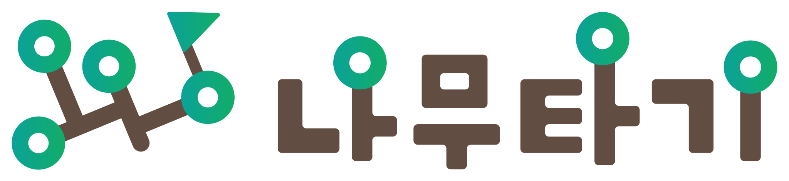
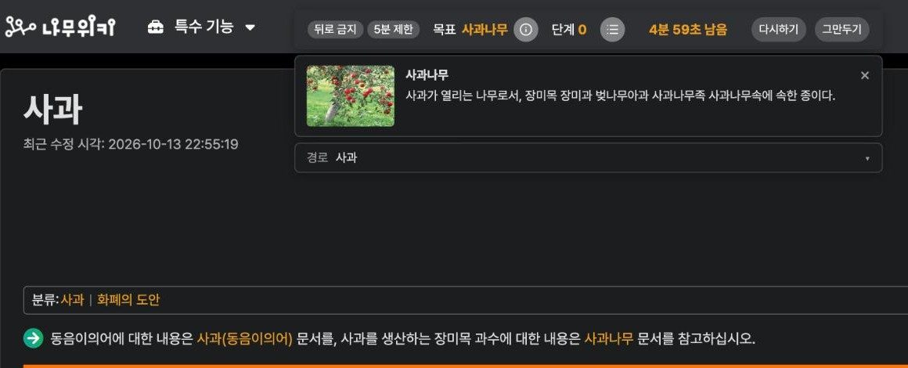
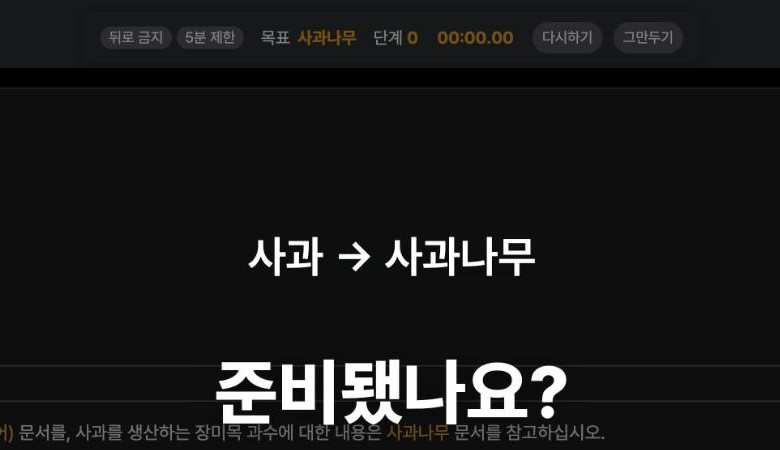
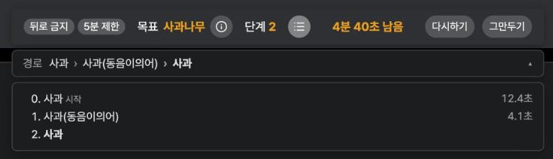
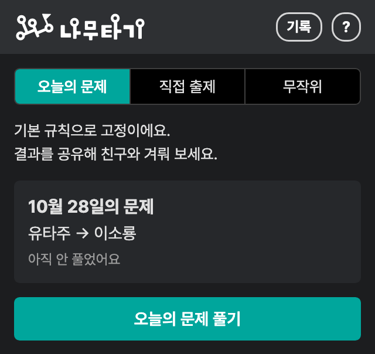
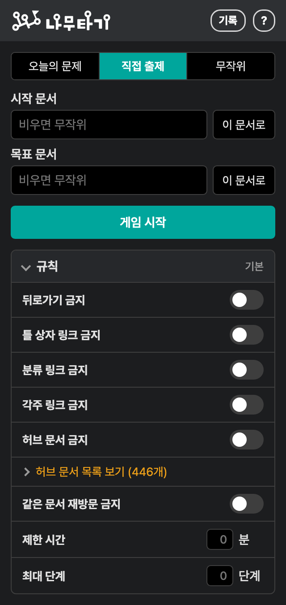
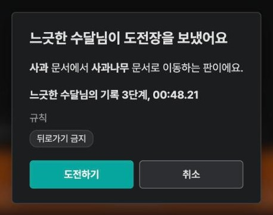
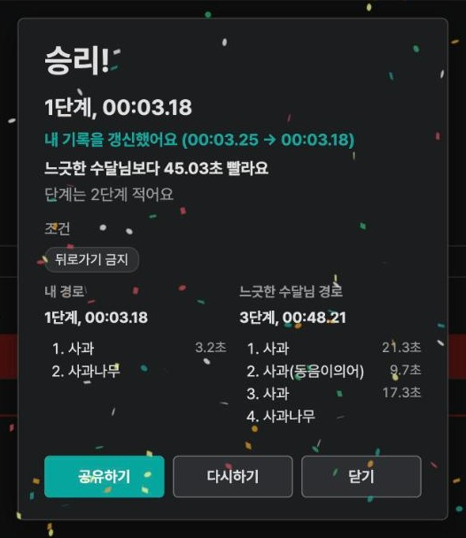
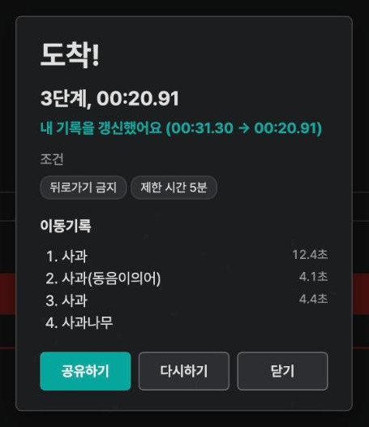
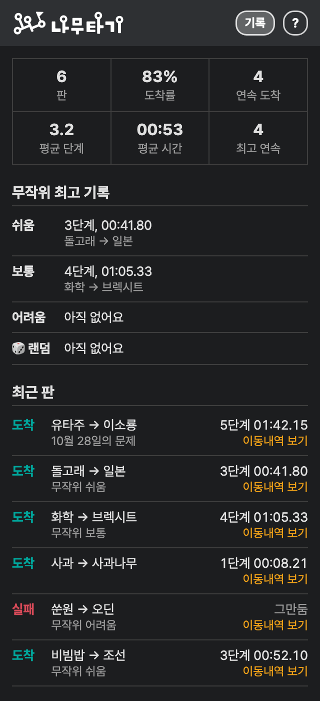

<h1>
  <picture>
    <source media="(prefers-color-scheme: dark)" srcset="design/wordmark-dark.svg">
    
  </picture>
</h1>

**나무타기**는 나무위키에서 즐기는 파도타기(위키레이싱) 게임입니다.
시작 문서에서 목표 문서까지 본문 링크만 눌러서 찾아가 보세요.
더 적은 단계, 더 짧은 시간으로 도착할수록 좋은 기록입니다.

> [!IMPORTANT]
> 이 확장은 나무위키나 umanle S.R.L.이 만들거나 배포한 것이 **아닙니다**.
> 개인이 만든 비공식 게임이며, 판매하거나 수익을 얻지 않습니다.

## 기능

<p align="center"></p>

**문제 고르기**
- 오늘의 문제: 하루에 하나, 모두에게 같은 문제 (규칙은 기본으로 고정)
- 직접 출제: 시작 문서와 목표 문서를 직접 정하기, 비워 두면 무작위로 정하기
- 무작위: 난이도(쉬움, 보통, 어려움, 랜덤)만 고르면 시작과 목표를 정하기
- 나무위키 검색창과 같은 문서 이름 추천, 동음이의어 문서는 뜻을 골라서 시작

**게임 중**
- 카운트다운이 끝나면 시간 측정 시작
- 화면 위 진행 막대에 목표, 단계, 시간, 켜 둔 규칙 표시
- 목표 문서 미리보기와 지나온 경로 보기
- 검색창, 랜덤 버튼, 편집 링크처럼 게임을 건너뛰는 길은 숨기거나 막기
- 문제가 마음에 들지 않으면 새 문제로 바꾸기, 같은 문제를 처음부터 다시하기

<p align="center"></p>
<p align="center"></p>

**규칙 옵션**
- 뒤로가기 금지, 틀 상자 링크 금지, 분류 링크 금지, 각주 링크 금지
- 허브 문서 금지 (대한민국, 미국처럼 어디서나 닿는 문서는 지나갈 수 없음)
- 같은 문서 재방문 금지, 제한 시간, 최대 단계

<table>
  <tr>
    <td valign="top"></td>
    <td valign="top"></td>
  </tr>
</table>

**도전장**
- 도착하면 내 기록과 경로가 담긴 링크를 복사해 친구에게 보내기
- 링크를 받은 친구는 같은 문제, 같은 규칙으로 대결 (시간이 빠른 쪽이 승리, 같으면 단계가 적은 쪽)
- 상대의 경로는 이겨야만 볼 수 있음

<table>
  <tr>
    <td valign="top"></td>
    <td valign="top"></td>
  </tr>
</table>

**기록**
- 도착률, 평균 단계와 시간, 연속 도착, 무작위 난이도별 최고 기록
- 최근 판의 이동 경로와 문서마다 머문 시간
- 규칙별로 나눠 보기
- 내 기록을 깨거나 도전장에서 이기거나 오늘의 문제를 풀면 폭죽

<table>
  <tr>
    <td valign="top"></td>
    <td valign="top"></td>
  </tr>
</table>

## 게임 규칙

**단계 세는 법**
- 링크를 눌러 다른 문서로 가면 1단계입니다. 뒤로가기와 앞으로가기도 1단계로 셉니다.
- 목차와 각주로 이동하는 것은 세지 않습니다.
- 새로고침해도 게임은 그대로 이어집니다.

**게임 중에 쓸 수 없는 것**
- 검색창, 랜덤 버튼, 실시간 검색어, 최근 변경
- 편집, 토론, 역사 링크
- 외부 링크, 없는 문서, 파일이나 사용자 같은 다른 이름공간 문서
- 새 탭으로 열기, 찾기(Ctrl+F), 나무위키 단축키 A, E, D

**이러면 집니다**
- 다른 탭이나 창으로 가면 경고가 뜨고, 한 번 더 가면 실격입니다.
- 30초 넘게 게임 화면을 떠나 있으면 바로 집니다.
- 개발자 도구를 열거나, 주소창에 직접 입력해서 다른 문서로 가면 집니다.

제한 시간이 없는 판에서 5분 동안 아무 입력이 없으면 "아직 하고 계세요?" 창이 뜨고, 그때부터 시계가 멈춥니다.

## 설치

[크롬 웹스토어](https://chromewebstore.google.com/detail/namutagi/fiadjnefijhjdngbdcaoahcdhkbnckfi)에서 설치할 수 있습니다(심사를 마치면 열립니다).

직접 설치하려면 다음 순서를 따라 주세요.

1. [Releases](../../releases)에서 최신 `namu-tagi-v*.zip`을 내려받아 압축을 풉니다.
2. 크롬에서 `chrome://extensions`를 열고 오른쪽 위 **개발자 모드**를 켭니다.
3. **압축해제된 확장 프로그램을 로드합니다**를 누르고 압축을 푼 폴더를 선택합니다.

> [!TIP]
> 설치하기 전에 열어 둔 나무위키 탭은 새로고침해야 나무타기가 동작합니다.
> 주소창 오른쪽의 퍼즐 조각 아이콘에서 나무타기를 고정해 두면 언제든 바로 열 수 있습니다.

## 개발

빌드 과정 없이 `extension` 폴더를 그대로 불러오면 됩니다.

```bash
node scripts/build-words.mjs    # 무작위 단어 목록(extension/words.js) 다시 만들기, 나무위키를 1초 간격으로 조사
node scripts/build-hubs.mjs     # 허브 문서 목록(extension/hubs.js) 다시 만들기
node scripts/check-daily.mjs    # 오늘의 문제가 겹치지 않는지 확인
python3 e2e/popup-harness/build.py <빈 폴더>    # 팝업을 localhost에서 열어 보는 시험 페이지 만들기
mkdir -p dist && git archive --format=zip -o dist/namu-tagi-v$(node -p "require('./extension/manifest.json').version").zip HEAD:extension    # 웹스토어에 올릴 zip 만들기(커밋된 extension 폴더만 담음)
```

## 개인정보

- 기록, 닉네임, 규칙 설정은 브라우저 안(`chrome.storage.local`)에만 저장됩니다. 확장을 지우면 함께 지워집니다.
- 공유하기로 도전장 링크를 만들 때만 닉네임, 문제, 경로, 기록, 익명 ID를 짧은 링크 서버(namutagi.com)로 보냅니다. 그 밖의 사용자 정보나 이용 기록은 수집하거나 보내지 않습니다.
- 나무위키(namu.wiki) 페이지에서만 동작하고, 네트워크 요청은 나무위키와 짧은 링크 서버로만 보냅니다.
- 도전장 링크를 아는 사람은 그 안의 닉네임, 기록, 경로를 볼 수 있습니다. 링크는 직접 공유할 때만 다른 사람에게 전해집니다.
- 권한은 `activeTab`(팝업을 연 탭이 나무위키인지 확인하고 문서 이름을 추천), `contextMenus`(나무위키 우클릭 메뉴), `storage`(기록 저장) 세 가지뿐입니다.

## 면책사항

- 이 소프트웨어는 "있는 그대로" 제공되며, 어떠한 보증도 하지 않습니다.
- 나무위키가 업데이트되면 일부 기능이 예고 없이 동작하지 않을 수 있습니다.
- 나무위키와 관련 명칭, 로고의 권리는 umanle S.R.L.에 있으며, 이 프로젝트는 그 회사와 관계가 없습니다.

## 라이선스

[MIT License](LICENSE)

함께 포함된 외부 라이브러리는 각자의 라이선스를 따릅니다. 전문은 `extension/vendor/`에 있습니다.

| 라이브러리 | 용도 | 라이선스 |
| --- | --- | --- |
| [canvas-confetti](https://github.com/catdad/canvas-confetti) 1.9.4 | 폭죽 효과 | ISC |
| [Lucide](https://lucide.dev) | 진행 막대 아이콘 | ISC (일부 Feather, MIT) |
